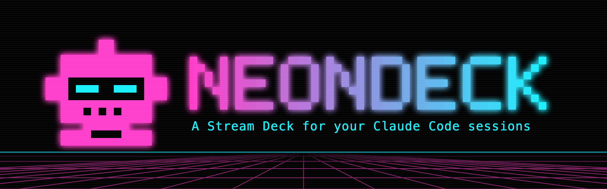
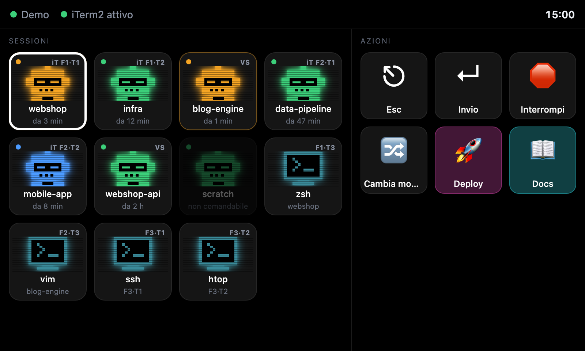
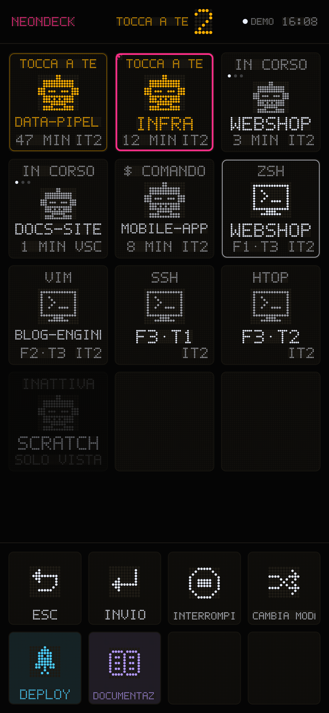
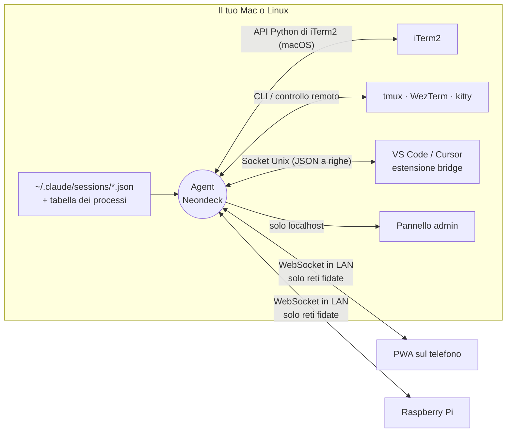

<p align="center">
  
</p>

<p align="center">
  <b>Un telecomando in stile Stream Deck per le tue sessioni Claude Code.</b><br>
  Vedi tutte le sessioni a colpo d'occhio, saltaci con un tocco e lancia i tuoi pulsanti dal telefono o da un Raspberry Pi.
</p>

<p align="center">
  <a href="https://github.com/matteofrige/neondeck/actions/workflows/ci.yml"></a>
  <a href="LICENSE"></a>
  
  
  
  
</p>

<p align="center">
  <a href="README.md">🇬🇧 English</a> · <a href="https://matteofrige.github.io/neondeck/demo.html">Demo online</a> · <a href="CHANGELOG.md">Changelog</a>
</p>

---

Neondeck è un piccolo agent per macOS e Linux con un'interfaccia web pensata per il touch. Se usi molte sessioni [Claude Code](https://claude.com/claude-code) contemporaneamente, sparse tra pannelli di iTerm2, tmux, WezTerm o kitty e terminali integrati di VS Code, le trasforma in una griglia di tessere sul telefono o su un piccolo schermo Raspberry Pi: quali stanno lavorando, quali aspettano te, quale è quale. Tocchi una tessera e quel terminale esatto passa in primo piano sul computer. Poi usi una fila di pulsanti personalizzabili (invio tasti, comando shell, URL, salto a una sessione) per rispondere, interrompere, cambiare modalità o fare un deploy senza toccare la tastiera.

<p align="center">
  
  &nbsp;&nbsp;
  
</p>

> **Non affiliato ad Anthropic.** Neondeck è un progetto indipendente. Legge i file di sessione locali che scrive Claude Code e controlla i tuoi terminali; non comunica con nessun servizio Anthropic. Vedi [Licenza e avvertenze](#licenza-e-avvertenze).

## Funzionalità

- 🟢 **Griglia delle sessioni in tempo reale.** Una tessera per sessione con il suo stato: al lavoro (busy), inattiva o in attesa di te, oppure una semplice shell. Le tessere si aggiornano man mano.
- 👆 **Tocca per mettere a fuoco.** Porta in primo piano la finestra, la scheda *e* il pannello giusti in iTerm2, tmux, WezTerm o kitty, oppure il terminale giusto in VS Code.
- 🖥️ **Tutti i pannelli dei terminali, non solo Claude.** `zsh`, `vim`, `ssh`, `htop`... ogni pannello ha la sua tessera (si può disattivare).
- 🐧 **macOS e Linux.** Lo stesso agent gira come LaunchAgent su macOS e come servizio utente systemd su Linux. tmux funziona su entrambi e copre anche i terminali senza API propria (Terminal.app, Ghostty, Alacritty, GNOME Terminal, Konsole...).
- 🧩 **Terminali integrati di VS Code** tramite una minuscola estensione bridge (Cursor funziona in modalità best-effort).
- 🎛️ **Pulsanti Stream Deck personalizzati.** Invio tasti, comando shell, apertura di un URL o salto a una sessione per nome, con emoji o immagini caricate e colori opzionali.
- 📱 **PWA per il telefono con abbinamento via QR.** Scansioni una volta, aggiungi alla schermata Home, fatto.
- 🥧 **Dispositivo Raspberry Pi.** Layout per touch screen 800x480, pensato per un Pi Zero 2 W (vedi [Costruire il dispositivo Raspberry Pi](#costruire-il-dispositivo-raspberry-pi)).
- 🔒 **Sicurezza di default.** Il listener di rete esiste solo sulle reti fidate, una chiave admin protegge le impostazioni, i tentativi falliti sono limitati e un dispositivo può solo premere i pulsanti che hai definito (non può mai inviare testo o comandi arbitrari). Dettagli in [Sicurezza](#sicurezza).
- 🪶 **Impronta minima.** Circa 57 MB di RAM, praticamente zero CPU quando nessuno è collegato, e non tiene mai sveglio il computer.

## Come funziona



L'agent legge i file di sessione che Claude Code tiene in `~/.claude/sessions`, risale l'albero dei processi (`ps` su macOS, `/proc` su Linux, al più una volta per ciclo) per capire quale terminale ospita ogni sessione, e chiede al terminale (API Python di iTerm2, `tmux`, `wezterm cli`, `kitty @`) o al bridge di VS Code (socket Unix) di mettere a fuoco un pannello o di scriverci dentro. Le sessioni Claude sono associate ai pannelli tramite la tty. I dispositivi si collegano via WebSocket, ricevono lo stato completo a ogni cambiamento e rispondono con due tipi di richiesta: *metti a fuoco questa tessera* e *premi questo pulsante*.

## Requisiti e piattaforme supportate

- macOS o Linux (Python 3.12+). Su macOS l'agent usa `launchd`, `scutil`, `lsappinfo` e `open`; su Linux legge `/proc` e usa `ip` (iproute2), `systemd --user` e `xdg-open`. Gli altri sistemi si fermano all'avvio con «Piattaforma non supportata» (Windows è un possibile obiettivo futuro).
- [uv](https://docs.astral.sh/uv/) per installarlo.
- Almeno un terminale supportato (vedi sotto). iTerm2 richiede l'**API Python abilitata**: *iTerm2 › Settings › General › Magic › Enable Python API*; iTerm2 chiede l'autorizzazione alla prima connessione dell'agent.
- Facoltativo: VS Code e/o Cursor per il bridge dei terminali integrati; `xdotool` su Linux/X11 per portare le finestre in primo piano.
- Un telefono o un Raspberry Pi sulla stessa rete Wi-Fi.

| Terminale | macOS | Linux | Come viene pilotato |
|---|:-:|:-:|---|
| iTerm2 | sì | n/d | API Python |
| tmux | sì | sì | CLI `tmux` sul server predefinito (può girare in qualunque emulatore di terminale) |
| WezTerm | sì | sì | `wezterm cli` |
| kitty | sì | sì | controllo remoto `kitty @` (da abilitare, vedi [kitty](#kitty)) |
| VS Code / Cursor | sì | sì | estensione bridge |
| Terminal.app, Ghostty, Alacritty | via tmux | via tmux (Ghostty, Alacritty) | esegui `claude` dentro tmux |
| GNOME Terminal, Konsole, altri | n/d | via tmux | esegui `claude` dentro tmux |

Il supporto a Linux è nuovo nella 0.4.0. La suite di test (con un vero server tmux) gira su Ubuntu e macOS in CI; portare in primo piano le finestre del desktop è best-effort (X11 con `xdotool`; Wayland non lo permette, vedi [Note su Linux](#note-su-linux)).

## Avvio rapido

```bash
uv tool install git+https://github.com/matteofrige/neondeck
neondeck install
neondeck qr
```

`neondeck install` crea il servizio in background (un LaunchAgent su macOS, log in `~/Library/Logs/neondeck.log`; un servizio utente systemd su Linux, vedi [Note su Linux](#note-su-linux)), installa l'estensione nei VS Code / Cursor che trova, marca come fidata la rete corrente se non ne hai ancora, e mostra l'indirizzo per il telefono con un QR code. Scansionalo dal telefono collegato alla stessa Wi-Fi.

Niente fotocamera, o nessuna voglia di digitare il token? Apri l'indirizzo sul telefono e tocca **ABBINA**: il telefono mostra un codice di 6 cifre, che approvi sul computer nel pannello admin, con `neondeck pair` o dalla notifica di macOS che ti rimanda lì. Le richieste scadono dopo 2 minuti e valgono i soliti controlli di rete; restano disponibili sia il token incollato sia la scansione del QR da foto.

Su Linux:

```bash
uv tool install git+https://github.com/matteofrige/neondeck.git
neondeck install      # scrive ~/.config/systemd/user/neondeck.service e lo abilita
journalctl --user -u neondeck -f
```

> 💡 **Aggiungi alla schermata Home.** Su iPhone: Condividi › *Aggiungi alla schermata Home* (su Android: menu › *Installa app*). Si apre a schermo intero come un'app nativa. Il QR code punta a `http://neondeck.local:8787` (annunciato via mDNS, nome configurabile con `lan_hostname` in `config.json`), quindi l'app installata continua a funzionare quando cambia l'IP del Mac; se il nome non si risolve, usa l'URL con l'IP stampato da `neondeck qr`. La memoria dell'app è separata da Safari, ma il manifest porta con sé il token, quindi di norma parte già abbinata; se lo chiede comunque, tocca ABBINA o incolla l'output di `neondeck token`.

Provalo senza installare nulla: la [demo online](https://matteofrige.github.io/neondeck/demo.html) esegue l'interfaccia con dati finti.

<details>
<summary><b>Aggiornamento, disinstallazione, passaggio da "Claude Deck"</b></summary>

```bash
uv tool upgrade neondeck && neondeck install      # aggiornamento
neondeck uninstall                                # conserva la configurazione
neondeck uninstall --purge                        # elimina anche ~/.config/neondeck
uv tool uninstall neondeck
```

Neondeck si chiamava *Claude Deck*. Al primo avvio, se `~/.config/neondeck` non esiste ma esiste `~/.config/claude-deck`, le impostazioni (`config.json`, `buttons.json`, `icons/`) vengono copiate con gli stessi permessi e la vecchia cartella resta dov'è. `neondeck install` rimuove anche il vecchio LaunchAgent e la vecchia estensione di VS Code (macOS). La variabile d'ambiente `CLAUDE_DECK_HOME` è ancora accettata come alternativa a `NEONDECK_HOME`. I telefoni abbinati prima del cambio di nome continuano a funzionare; i client Bonjour ora devono cercare `_neondeck._tcp`.

</details>

## HTTPS (facoltativo)

Di default il telefono parla con l'agent in HTTP semplice sulla tua LAN. Attiva HTTPS per cifrare token e traffico e per avere la fotocamera dal vivo nella scansione del QR (i browser consentono la fotocamera solo su pagine sicure).

```bash
neondeck tls enable      # crea la CA e il certificato del server, riavvia l'agent
```

Poi, una sola volta per telefono:

1. Apri con **Safari** l'indirizzo di setup stampato dal comando (o inquadra il QR di `neondeck qr`, che ora punta lì).
2. Tocca *Scarica profilo*, poi Impostazioni › *Profilo scaricato* › Installa.
3. Impostazioni › Generali › Info › Impostazioni certificati attendibili: attiva **Neondeck Local CA**.
4. Apri l'indirizzo `https://neondeck.local:8787` e tocca **ABBINA**, poi Aggiungi a Home.

Su Android: scarica il `.crt` dalla pagina di setup, poi Impostazioni › Sicurezza › Crittografia e credenziali › Installa un certificato › Certificato CA.

L'app installata dal vecchio indirizzo `http://` ha un'origine diversa: eliminala e aggiungi quella HTTPS. La pagina di setup resta in HTTP semplice (porta 8786, stessi controlli di rete) perché il telefono deve scaricare il certificato prima di potersi fidare di qualcosa.

La CA sta in `~/.config/neondeck/tls/` (chiavi con permessi 600). È **vincolata nei nomi** (name constraints): può firmare solo nomi `.local` e intervalli IP privati o di loopback, quindi se la sua chiave venisse rubata non servirebbe a impersonare siti pubblici. Il certificato del server si rinnova da solo. `neondeck tls rotate` crea una nuova CA (ogni telefono deve reinstallare il profilo e rimuovere il vecchio da Impostazioni › Generali › VPN e gestione dispositivi); `neondeck tls disable` torna a HTTP e conserva i file.

## Riferimento CLI

Esegui `neondeck` senza argomenti per avviare il server in primo piano (come `neondeck run`).

| Comando | Descrizione |
|---|---|
| `neondeck` / `neondeck run` | Avvia l'agent in primo piano. |
| `neondeck install [--no-vscode] [--no-service]` | Installa il servizio in background (LaunchAgent su macOS, unit utente systemd su Linux) e l'estensione VS Code / Cursor, marca come fidata la rete corrente se non ce ne sono ancora, mostra il QR code. `--no-launchd` resta come alias di `--no-service`. Su macOS rimuove anche il vecchio agent e la vecchia estensione *Claude Deck*. |
| `neondeck uninstall [--purge]` | Rimuove servizio ed estensione. `--purge` elimina anche la cartella dati. |
| `neondeck status` | Stato di servizio, server, listener LAN, Bonjour, rete fidata, terminali rilevati (`tmux: attivo (3 sessioni, 7 pannelli)`, `WezTerm: non trovato`, `kitty: remote control disattivato`, `iTerm2: ...`, `VS Code bridge: n finestre`), socket del bridge ed estensione. |
| `neondeck restart` | Riavvia l'agent (`launchctl kickstart -k` o `systemctl --user restart`). |
| `neondeck qr` | Stampa l'indirizzo per il telefono e un QR code. |
| `neondeck pair [CODICE]` | Approva una richiesta di abbinamento del telefono: elenca quelle in attesa e chiede conferma per ciascuna, oppure approva subito `CODICE`. |
| `neondeck tls [status\|enable\|disable\|rotate]` | HTTPS facoltativo con una CA locale, vedi [HTTPS](#https-facoltativo). |
| `neondeck token [--rotate] [--admin]` | Stampa il token dei dispositivi (o la chiave admin con `--admin`); `--rotate` ne genera uno nuovo. |
| `neondeck trust [--name NOME]` | Marca la rete corrente come fidata. |
| `neondeck networks` | Elenca le reti fidate e segna quella corrente. |
| `neondeck untrust <MAC\|NOME\|N>` | Rimuove una rete fidata per MAC, nome o numero d'ordine. |
| `neondeck admin` | Apre il pannello admin nel browser (`open` / `xdg-open`; se non esistono stampa l'URL). La chiave viaggia nel frammento dell'URL. |
| `neondeck vsix [-o PERCORSO]` | Crea il pacchetto `.vsix` dell'estensione VS Code. |
| `neondeck --version` | Stampa la versione. |

I comandi che modificano `config.json` (`trust`, `untrust`, `token --rotate`) sono letti dall'agent in esecuzione senza riavvio.

## Configurazione

Tutto sta in `~/.config/neondeck/` (modificabile con `NEONDECK_HOME`; su Linux vale `XDG_CONFIG_HOME`). La cartella è creata con permessi 700 e `config.json` con permessi 600.

<details>
<summary><b>Campi di <code>config.json</code></b></summary>

| Campo | Predefinito | Significato |
|---|---|---|
| `port` | `8787` | Porta HTTP / WebSocket. |
| `token` | generato | Segreto usato dai dispositivi (header `Authorization: Bearer`, oppure `?token=` sul WebSocket). |
| `admin_key` | generata | Segreto del pannello admin (`X-Admin-Key`). |
| `trusted_networks` | `[]` | Reti in cui il listener LAN è consentito: `{name, mac, subnet, added}`, identificate dal MAC del gateway. Si gestiscono con `neondeck trust` / `untrust` o dal pannello admin. |
| `bind` | non impostato | Imposta `127.0.0.1` per la modalità solo locale: il listener LAN non parte mai. |
| `show_all_terminals` | `true` | Mostra come tessera ogni pannello dei terminali (iTerm2, tmux, WezTerm, kitty), non solo quelli di Claude Code (è anche un'opzione nel pannello admin). La vecchia chiave `show_all_iterm` è ancora letta se manca la nuova. |
| `tmux_socket` | non impostato | Percorso del socket del server tmux da usare al posto del predefinito `$TMUX_TMPDIR/tmux-<uid>/default`. Serve se la tua shell imposta `TMUX_TMPDIR` o usi `tmux -L`. Letto all'avvio. |
| `kitty_socket` | non impostato | Indirizzo `--to` di kitty (per esempio `unix:/tmp/kitty-1234`) al posto della ricerca automatica di `/tmp/kitty*`. Letto all'avvio. |

</details>

<details>
<summary><b>Schema di <code>buttons.json</code> ed esempi</b></summary>

Un array di pulsanti. Ogni pulsante ha `id`, `title` (da 1 a 40 caratteri), `icon` (`{"type": "glyph", "value": "rocket"}` per un simbolo LED a matrice di punti (`esc`, `enter`, `stop`, `mode`, `tab`, `up`, `down`, `rocket`, `book`, `bolt`, `terminal`, `refresh`, `play`, `check`), `{"type": "emoji", "value": "🚀"}` oppure `{"type": "image", "value": "icons/nome.png"}`), un `color` facoltativo (`#rrggbb`) e un'`action`. Il modo più semplice per modificarli è il pannello admin (`neondeck admin`), che carica anche le immagini (png, jpg, gif, webp o svg, fino a 2 MB) in `icons/`.

Al primo avvio vengono creati quattro pulsanti: Esc, Invio, Interrompi (Ctrl+C) e Cambia modalità (Shift+Tab).

```json
[
  {
    "id": "enter",
    "title": "Invio",
    "icon": { "type": "glyph", "value": "enter" },
    "action": { "type": "send_keys", "text": "\r", "target": "current" }
  },
  {
    "id": "deploy",
    "title": "Deploy",
    "icon": { "type": "emoji", "value": "🚀" },
    "color": "#ff3cc7",
    "action": { "type": "shell", "command": "./deploy.sh", "timeout": 60 }
  },
  {
    "id": "docs",
    "title": "Docs",
    "icon": { "type": "image", "value": "icons/docs.png" },
    "action": { "type": "open_url", "url": "https://example.com/docs" }
  },
  {
    "id": "jump-infra",
    "title": "Infra",
    "icon": { "type": "emoji", "value": "🏗️" },
    "action": { "type": "focus_session", "match": "infra" }
  }
]
```

| Azione | Campi | Comportamento |
|---|---|---|
| `send_keys` | `text`, `target` = `current` o `selected` | Scrive il testo in una sessione, senza premere Invio a meno che `text` contenga `\r`. `current` è la sessione in primo piano (il pannello attivo del terminale frontmost, oppure il terminale attivo della finestra VS Code a fuoco), con ripiego sull'ultima tessera messa a fuoco da un dispositivo; `selected` è la tessera selezionata sul dispositivo. |
| `shell` | `command`, `timeout` (da 1 a 600 s, predefinito 10) | Esegue `/bin/zsh -lc <comando>` (macOS) o `/bin/bash -lc <comando>` (Linux) sul computer e riporta il codice di uscita e gli ultimi 500 caratteri di output. |
| `open_url` | `url` (serve uno schema) | Esegue `open <url>` (macOS) o `xdg-open <url>` (Linux). |
| `focus_session` | `match` | Mette a fuoco la prima sessione il cui nome o progetto contiene il testo. Funziona anche sulle tessere dei terminali. |

</details>

## Le tessere delle sessioni

<details open>
<summary><b>Come leggere la griglia</b></summary>

- **Chi aspetta te.** L'ambra ha un solo significato: una sessione Claude Code che aspetta te ("TOCCA A TE", con la scritta che lampeggia come un treno in partenza). La testata ne mostra il numero in grande, in ambra, e quelle tessere vengono ordinate per prime.
- **Altri stati.** LED bianchi a intensità ridotta: *in corso* (sta lavorando, con tre punti che si rincorrono), *comando* (un comando shell, segnato con `$`), pannelli di terminale (icona a monitor e nome del programma in esecuzione). Le sessioni di sola visione sono attenuate; gli spazi vuoti mostrano moduli spenti. Quando una tessera cambia stato si ridisegna con una passata di LED da sinistra a destra.
- **Contorni.** Un contorno bianco sottile segna la sessione attualmente in primo piano sul computer; un contorno magenta segna la tessera selezionata sul dispositivo (la destinazione dei pulsanti `selected`).
- **Codice dell'host.** In basso a destra di ogni tessera: `IT2` = iTerm2, `TMX` = tmux, `WZT` = WezTerm, `KTY` = kitty, `VSC` = VS Code / Cursor.
- **Etichetta di posizione.** iTerm2: `F1·T2` = finestra 1, scheda 2; `F1·T2·P2` aggiunge il pannello 2 quando la scheda è divisa (le finestre seguono l'ordine di iTerm2). tmux: `tmux work:2.1` = sessione `work`, finestra 2, pannello 1. WezTerm e kitty: `wezterm 1:2.1` / `kitty 1:2.1` = finestra 1, scheda 2, pannello 1.
- **Sottotitolo.** Il tempo nello stato corrente per le tessere Claude («da 3 min»); la cartella corrente o la posizione per i terminali.
- **Tessere non comandabili.** Le sessioni in un terminale che l'agent non può pilotare (Terminal.app o Ghostty senza tmux, una finestra VS Code senza bridge, ...) sono attenuate, mostrano «non comandabile» e non si possono selezionare.
- **Ordine.** Prima le sessioni Claude comandabili, poi i terminali per finestra / scheda / pannello, in fondo le sessioni non comandabili. Se un pannello esegue una sessione Claude Code, compare solo la tessera Claude. Le sessioni iTerm2 che ospitano solo `tmux -CC` sono nascoste: i pannelli tmux dietro di esse hanno le loro tessere.

</details>

## Terminali

L'agent interroga i terminali solo mentre un dispositivo è collegato, e solo quelli disponibili.

### tmux

tmux funziona su macOS e Linux ed è il modo per controllare gli emulatori di terminale senza API propria (Terminal.app, Ghostty, Alacritty, GNOME Terminal, Konsole...).

- **Esegui `claude` dentro tmux** (`tmux new -s work`, poi `claude`). Ogni pannello diventa una tessera; una sessione Claude è associata al suo pannello tramite la tty.
- L'agent parla con il server predefinito, `$TMUX_TMPDIR/tmux-<uid>/default` (`/tmp` se non impostato). Un servizio non vede il `TMUX_TMPDIR` del tuo profilo shell e non può indovinare i socket di `tmux -L nome`: per questi imposta `tmux_socket` in `config.json`. Senza socket del server l'agent non lancia nemmeno `tmux`.
- **Tocca una tessera** e l'agent seleziona finestra e pannello, porta il client tmux usato più di recente su quella sessione (`switch-client`) e poi porta in primo piano la finestra del terminale che ospita quel client: tramite l'API di iTerm2, `open -a` su macOS, `xdotool` su Linux/X11 (Wayland: il pannello viene selezionato ma la finestra non si sposta). Senza client collegati il pannello viene comunque selezionato e l'interfaccia mostra «Nessun client tmux collegato».
- I tasti sono inviati come byte grezzi (`send-keys -H`, tmux 3.0 o successivo), quindi i pulsanti Esc, Ctrl+C e Shift+Tab funzionano. Con un tmux più vecchio si ripiega sui tasti letterali con un avviso.
- **`tmux -CC` di iTerm2:** la sessione iTerm2 che esegue il client di controllo è nascosta e le tessere vanno ai pannelli tmux.

### WezTerm

Servono `wezterm` nel `PATH` e una finestra WezTerm aperta. L'agent usa `wezterm cli list`, `activate-pane` e `send-text --no-paste`; il pannello a fuoco viene da `wezterm cli list-clients`. Se l'agent gira come servizio trova la GUI tramite il socket predefinito di WezTerm; se `wezterm cli list` funziona in un terminale ma non per l'agent, avvia l'agent da quel terminale con `WEZTERM_UNIX_SOCKET` impostato.

### kitty

kitty risponde a `kitty @` solo se il controllo remoto è attivo. Aggiungi a `kitty.conf` e riavvia kitty:

```conf
allow_remote_control socket-only
listen_on unix:/tmp/kitty
```

kitty può aggiungere il proprio process id al nome del socket (per esempio `/tmp/kitty-1234`): l'agent prova `$KITTY_LISTEN_ON` e ogni socket che corrisponde a `/tmp/kitty*`, oppure l'indirizzo in `kitty_socket`. Finché il controllo remoto non funziona, `neondeck status` mostra «kitty: remote control disattivato». kitty non espone la tty, quindi le sessioni Claude sono associate alle finestre tramite il process id della shell. I tasti sono inviati così come sono (`send-text --stdin`).

## Note su Linux

- **Servizio.** `neondeck install` scrive `~/.config/systemd/user/neondeck.service` (`ExecStart=<neondeck> run`, `Restart=on-failure`, `PATH` con `~/.local/bin`, `NEONDECK_HOME` se impostata), poi esegue `systemctl --user daemon-reload` e `enable --now`. Log: `journalctl --user -u neondeck -f`. Il servizio utente gira solo mentre sei collegato; per farlo girare senza una sessione di login (un server headless) usa `sudo loginctl enable-linger $USER`. Senza un'istanza systemd utente (container, alcuni setup WSL) `neondeck install` lo spiega e lanci tu `neondeck run`.
- **Firewall.** I dispositivi si collegano alla porta di `config.json` (8787). Se `ufw` è attivo, consenti solo la tua LAN: `sudo ufw allow from 192.168.1.0/24 to any port 8787 proto tcp` (usa la sottorete che mostra `neondeck networks`). Neondeck respinge comunque le richieste da fuori dalla sottorete della rete fidata.
- **Riconoscimento della rete** con `ip -j route`/`neigh`/`addr` (iproute2), con ripiego su `/proc/net/route` e `/proc/net/arp`. Le reti fidate si identificano dal MAC del gateway, nello stesso formato di macOS.
- **Finestre e fuoco.** Su X11 installa `xdotool`: l'agent lo usa per sapere quale app è in primo piano e per portare in primo piano una finestra di terminale. Sotto Wayland non c'è modo portabile per nessuna delle due cose, quindi Neondeck le salta in silenzio: il contorno «a fuoco» segue allora ciò che riporta ogni terminale (tmux, WezTerm e kitty conoscono il loro pannello attivo) e toccare una tessera seleziona il pannello senza spostare la finestra. Se il servizio non vede il tuo display, importalo una volta: `systemctl --user import-environment DISPLAY XAUTHORITY`.
- **Sessioni.** `ps` non si usa; la tabella dei processi viene da `/proc`.

## Bridge VS Code

VS Code non ha un'API esterna per il terminale integrato, quindi `neondeck install` installa una piccola estensione (JavaScript semplice, senza dipendenze né build; `src/neondeck/vscode_bridge/`). Comunica il PID della shell di ogni terminale tramite un socket Unix in `<NEONDECK_HOME>/bridge.sock` (permessi 600 in una cartella 700: nessuna rete, nessun token). L'agent associa una sessione Claude Code a un terminale quando la shell di quel terminale è fra i processi padre della sessione, poi chiede all'estensione di mostrare il terminale o di scriverci dentro. Le richieste scadono dopo 3 secondi.

Dopo l'installazione esegui **Developer: Reload Window** in ogni finestra dell'editor. L'estensione scrive nel pannello Output **Neondeck** e il comando **Neondeck: riconnetti** forza la riconnessione (riprova comunque da sola ogni 1-15 secondi). Senza CLI, esegui `neondeck vsix` e usa *Extensions: Install from VSIX...*.

Limiti:

- L'API delle estensioni non può portare in primo piano la finestra: dopo aver messo a fuoco il terminale l'agent lancia la CLI dell'editor sulla cartella dell'area di lavoro (oppure `open -a` se non c'è, su macOS). Su Linux cerca `code`, `code-insiders`, `codium` o `cursor` nel `PATH`, `/usr/share/code/bin/code` e `/snap/bin/code`; un window manager che impedisce di rubare il fuoco può lasciare la finestra sullo sfondo. Con più finestre sulla stessa cartella potrebbe salire quella sbagliata. Imposta `NEONDECK_NO_RAISE=1` per saltare questo passo.
- Cursor è best-effort (stessa estensione, CLI `cursor`).
- Le finestre remote (SSH, container, WSL) non sono supportate.

## Sicurezza

Neondeck permette a un dispositivo di premere tasti nei tuoi terminali, quindi è costruito per essere raggiungibile da meno cose possibile.

| Chi | Cosa può tentare | Difesa |
|---|---|---|
| Qualcuno sulla **tua Wi-Fi fidata** | Intercettare o indovinare il token, poi elencare le sessioni e premere i tuoi pulsanti | Il token è di 24 byte casuali; 5 token errati in 10 minuti bloccano l'IP per 10 minuti (429 / codice di chiusura 4429); il dispositivo può solo premere pulsanti predefiniti, mai inviare testo libero o comandi; i pulsanti shell si definiscono solo dal pannello admin. Ruota con `neondeck token --rotate`. |
| Qualcuno su una **Wi-Fi pubblica o non fidata** | Raggiungere l'agent | Non c'è nulla da raggiungere: l'agent ascolta solo sul loopback e apre il listener LAN solo mentre il computer è su una rete fidata (identificata dal MAC del gateway). Quando la rete cambia il socket viene chiuso, i client ricevono il codice 4403 e Bonjour viene ritirato. Le richieste sono respinte anche se il MAC del gateway non è determinabile (fail closed) o se l'IP del client è fuori dalla sottorete del computer. |
| Un **processo o utente locale** sul computer | Leggere il token, parlare con il bridge | `config.json` ha permessi 600 in una cartella 700; il socket del bridge è raggiungibile solo dal tuo utente. Qualunque cosa giri come te può comunque leggere i tuoi file. |
| Un **sito web malevolo** nel browser | Colpire `localhost:8787` (CSRF, DNS rebinding) per usare il pannello admin | `/api/admin/*` richiede l'header `X-Admin-Key` (mai inviato da una semplice richiesta cross-site), l'admin è solo localhost giudicato dall'indirizzo del socket (mai `X-Forwarded-For`), e `Host` / `Origin` sono controllati contro il DNS rebinding. |

Altri dettagli: le icone sono limitate a 2 MB e a tipi immagine, e gli SVG sono serviti con `Content-Security-Policy: default-src 'none'`. Connessioni, token errati, blocchi e reti respinte finiscono nel log.

**Sii onesto sui limiti.**

- Il traffico fra dispositivo e computer è **HTTP in chiaro** nella tua LAN, a meno che tu non attivi [HTTPS](#https-facoltativo). Chi può intercettare quella rete può leggere il token. Per questo il listener gira solo sulle reti che marchi esplicitamente come fidate.
- Un pulsante che invia **Invio può approvare una richiesta di permesso di Claude Code**. Chiunque abbia il token può farlo. Tratta il token come una password.

Consigli:

- Ruota il token se è stato condiviso o visto da altri: `neondeck token --rotate`.
- Non fidarti mai di reti pubbliche (bar, hotel, coworking, hotspot condivisi).
- Su una rete fidata ma non davvero tua, attiva la modalità invisibile (*stealth*) del firewall di macOS (Impostazioni di Sistema › Rete › Firewall › Opzioni).
- Su Linux, consenti la porta nel firewall solo dalla sottorete della tua LAN (vedi [Note su Linux](#note-su-linux)).
- Per usare solo l'anteprima sul computer, imposta `"bind": "127.0.0.1"` in `config.json`.

## Note su macOS

- Il **permesso Rete locale** serve solo per gli annunci **Bonjour** (auto-discovery da parte del Pi). Il riconoscimento della rete (MAC del gateway, IP, sottorete) legge configd tramite `scutil`, che macOS non filtra, quindi `neondeck trust` funziona anche con il Python gestito da uv. Solo se configd non fornisce il MAC del gateway l'agent ripiega su `route` / `arp`, che le versioni recenti di macOS filtrano per i binari senza permesso (in quel caso `neondeck status` mostra `localnet_permission`). Senza permesso il listener LAN parte comunque e i dispositivi si collegano tramite IP.
  Per abilitare Bonjour: Impostazioni di Sistema › Privacy e sicurezza › **Rete locale** › abilita il binario Python indicato nel messaggio di log, poi `neondeck restart`. Dopo un aggiornamento di Python tramite uv il percorso del binario cambia e il permesso va concesso di nuovo.
- **Avvii in sandbox.** Se esegui Neondeck dentro la sandbox `!` di Claude Code, `ps` è bloccato: l'agent non legge i processi e l'interfaccia mostra «Processi non leggibili». Avvialo da un terminale normale o con `neondeck install`.
- L'agent non impedisce mai la sospensione e gira senza problemi come LaunchAgent nella tua sessione di login. tmux, WezTerm e kitty funzionano anche su macOS; per Terminal.app e Ghostty esegui `claude` dentro tmux.

## Risorse

Misurato: circa **57 MB di RSS** e circa **0,6% di CPU** con un client collegato, circa 0 a riposo. Senza client collegati l'agent non fa nulla: nessun polling, nessuna scansione dei processi, nessun `lsappinfo`, nessuna chiamata a `tmux` / `wezterm` / `kitty`, nessuna scansione di iTerm2; si aggiorna subito alla prima connessione. L'unico timer sempre attivo è il controllo di rete ogni 30 secondi. Con client collegati l'app in primo piano viene letta al più ogni 2 secondi (`lsappinfo`, o `xdotool` su Linux) e solo se esiste un pannello di terminale o una sessione VS Code; i dettagli di iTerm2 si leggono una volta per sessione nuova e poi solo quando iTerm2 notifica un cambio; tmux costa una chiamata a `tmux` al secondo, WezTerm e kitty una o due al secondo, e solo se sono in esecuzione. Non tiene alcuna asserzione di alimentazione, quindi non impedisce al computer di andare in stop.

## Costruire il dispositivo Raspberry Pi

Il layout di `/preview` è pensato per uno schermo 800x480. Hardware consigliato:

- **Raspberry Pi Zero 2 W**, piccolo, economico, con Wi-Fi integrato.
- **Pimoroni HyperPixel 4.0 Touch** (800x480, touch capacitivo, si innesta sull'header GPIO). Lo Zero non ha il connettore DSI, ed è per questo che qui un display DSI ufficiale non è un'opzione.
- Scheda batteria **PiSugar 3 Plus 5000 mAh**.
- Una microSD.

Se preferisci i display DSI, un Compute Module 4 su una carrier adatta è un'alternativa.

**Stato: il client nativo è in lavorazione.** Nel frattempo puoi usare Chromium in modalità kiosk su un Pi 4 o 5 puntato su `http://<ip-dell-agent>:8787/preview?token=...&frame=1`, oppure semplicemente il telefono. `frame=1` forza il layout fisso 800x480.

## Riferimento del protocollo WebSocket

Tutti gli endpoint per i dispositivi richiedono una rete fidata e il token (`Authorization: Bearer <token>`, oppure `?token=` sul WebSocket), tranne i due endpoint di abbinamento, che richiedono solo la rete.

<details>
<summary><b>Endpoint HTTP</b></summary>

| Metodo | Percorso | Descrizione |
|---|---|---|
| GET | `/api/sessions` | `{"sessions": [...], "iterm": bool, "terminals": [{"id", "label"}, ...]}` |
| GET | `/api/buttons` | `{"buttons": [...]}` |
| POST | `/api/focus` `{"id"}` o `{"pid"}` | Mette a fuoco una tessera (`id` è `claude:<pid>`, oppure `<backend>:<id pannello>` per le tessere dei terminali, come `iterm:<sessione>` o `tmux:%3`; `pid` solo per le sessioni Claude). |
| POST | `/api/press` `{"id", "target_id"?, "pid"?}` | Preme un pulsante; `target_id` è la tessera selezionata sul dispositivo. Risposta `{"ok", "detail"}`. |
| POST | `/api/pair` | Abbinamento, senza token (solo rete fidata): `{"ok", "id", "code", "expires_in"}`. Massimo 5 per IP ogni 10 minuti. |
| GET | `/api/pair/<id>` | Stato dell'abbinamento `pending` / `denied` / `approved` (con `token`); 404 dopo la scadenza. |
| WS | `/ws?token=...` | Vedi sotto. |
| GET | `/preview` | Web app telecomando / simulatore (`?frame=1` fisso 800x480, `?demo=1` dati finti). |
| GET | `/icons/<file>` | Icone dei pulsanti (senza token). |

</details>

<details>
<summary><b>Messaggi WebSocket</b></summary>

Dal server al client:

- `{"type": "state", "sessions": [...], "buttons": [...], "iterm": bool, "terminals": [{"id", "label"}, ...]}`: inviato alla connessione e a ogni cambiamento; `terminals` elenca i backend disponibili.
- `{"type": "result", "ok": bool, "detail": str, "req": any}`: risposta a `focus` / `press`; `req` è restituito identico.
- `{"type": "pong"}`.

Dal client al server:

- `{"type": "focus", "id": "claude:123"}` (o `"pid"`).
- `{"type": "press", "id": "<id pulsante>", "target_id"?: "<id tessera>", "pid"?: n}`.
- `{"type": "ping"}`.

Codici di chiusura applicativi: **4401** token errato, **4403** rete non fidata, **4429** troppi tentativi.

Una tessera di sessione ha: `kind` (`claude` o `terminal`), `id`, `pid` (null per i terminali), `sessionId`, `name`, `cwd`, `project`, `status` (`busy`, `idle`, `shell`, `terminal`, ...), `statusSince` (ms), `startedAt`, `tty`, `host` (`iterm`, `tmux`, `wezterm`, `kitty`, `vscode`, `other`), `loc`, `controllable`, `focused`; le tessere dei terminali hanno anche `title`, `backend` e `paneId`.

Scoperta: servizio Bonjour `_neondeck._tcp.local.` sulla porta dell'agent, TXT `v=1` (il token non è mai annunciato).

</details>

## Sviluppo

```bash
uv sync
uv run neondeck run          # avvia l'agent dal checkout (senza servizio in background)
uv run pytest                # test (il test di integrazione tmux richiede tmux ed è saltato senza)
uv run neondeck vsix -o .    # crea il pacchetto dell'estensione VS Code
```

- **Modalità demo.** Apri `/preview?demo=1` su un agent in esecuzione, oppure `docs/demo.html` direttamente da disco: l'interfaccia mostra sessioni e pulsanti finti, senza WebSocket e senza token. `docs/demo.html` è generato da `src/neondeck/static/preview.html` con `python scripts/build_demo.py` (un test verifica che sia aggiornato) e può essere ospitato in modo statico, per esempio con GitHub Pages.
- **Smoke test Linux.** `scripts/linux-smoke.sh` costruisce `tests/docker/Dockerfile.linux` (Python 3.12 + tmux + iproute2), vi esegue tutta la suite di test e poi avvia l'agent contro un vero tmux, verificando che una sessione Claude finta diventi una tessera `tmux` comandabile e che gli altri pannelli diventino tessere terminale. Stampa PASS o FAIL per ogni controllo. La CI (`.github/workflows/ci.yml`) esegue la suite su Ubuntu e macOS.
- **Risorse grafiche.** `python scripts/build_assets.py` rigenera `docs/assets/logo.svg` e `banner.svg`. Gli screenshot (`screenshot-landscape.png` 800x480, `screenshot-phone.png` 390x844) si ricavano dalla demo con Chrome headless.

## Roadmap

- Client nativo per Raspberry Pi (LVGL o pygame) al posto del browser
- Controllo diretto di Terminal.app e Ghostty (oggi: tramite tmux)
- Supporto a Windows
- Token per singolo dispositivo
- Tap Homebrew
- App nella barra dei menu
- Interfaccia tradotta (oggi è in italiano)

## Risoluzione dei problemi

<details>
<summary><b>Una tessera è grigia e dice «non comandabile»</b></summary>

La sessione gira in un terminale che l'agent non può pilotare (qualunque cosa diversa da iTerm2, tmux, WezTerm, kitty o VS Code / Cursor: esegui `claude` dentro tmux), in un server tmux che l'agent non vede (imposta `tmux_socket`), oppure in una finestra VS Code dove il bridge non è collegato. Per VS Code: esegui *Developer: Reload Window*, poi controlla il pannello Output **Neondeck** e `neondeck status` (socket del bridge ed estensione). Le finestre remote di VS Code non sono supportate.

</details>

<details>
<summary><b>«Processi non leggibili» nell'intestazione</b></summary>

L'agent non è riuscito a leggere la tabella dei processi (`ps` su macOS, `/proc` su Linux). Succede quando parte dentro una sandbox (per esempio quella `!` di Claude Code). Avvialo con `neondeck install` o da un terminale normale.

</details>

<details>
<summary><b>Il telefono non si collega</b></summary>

Controlla in quest'ordine: telefono e computer sono sulla stessa Wi-Fi; quella rete è fidata (`neondeck networks`, poi `neondeck trust` da quella rete); l'agent è in esecuzione (`neondeck status`); il token è quello attuale (`neondeck token`). Una schermata «Rete non fidata» corrisponde al codice 4403; «Troppi tentativi» significa 5 token errati e un blocco di 10 minuti.

</details>

<details>
<summary><b>tmux, WezTerm o kitty non vengono rilevati</b></summary>

`neondeck status` elenca ogni terminale con il suo stato. tmux: «nessun server in esecuzione» significa che nel percorso predefinito non c'è un socket, quindi avvia prima tmux o imposta `tmux_socket`. WezTerm: «non in esecuzione» significa che `wezterm cli list` fallisce per l'agent. kitty: «remote control disattivato» significa che mancano `allow_remote_control` / `listen_on` in `kitty.conf` (vedi [kitty](#kitty)). La disponibilità di WezTerm e kitty viene ricontrollata ogni 30 secondi.

</details>

<details>
<summary><b>Su Linux toccare una tessera seleziona il pannello ma la finestra non passa in primo piano</b></summary>

Portare in primo piano le finestre richiede X11 e `xdotool`. Sotto Wayland non è possibile; il pannello viene comunque selezionato e la scrittura funziona. Sotto X11 controlla `which xdotool` e che il servizio veda `DISPLAY` (`systemctl --user import-environment DISPLAY XAUTHORITY`).

</details>

<details>
<summary><b>Su Linux il telefono non raggiunge l'agent</b></summary>

Oltre ai controlli qui sopra, verifica che il firewall lasci raggiungere la porta dalla tua LAN (`sudo ufw status`, poi `sudo ufw allow from <tua-sottorete> to any port 8787 proto tcp`).

</details>

<details>
<summary><b>iTerm2 risulta non disponibile</b></summary>

(Solo macOS.) Abilita *iTerm2 › Settings › General › Magic › Enable Python API* e accetta la richiesta di autorizzazione. L'agent si riconnette da solo; nel frattempo l'elenco delle sessioni continua a funzionare.

</details>

<details>
<summary><b>Bonjour non è attivo</b></summary>

Concedi il permesso Rete locale al binario Python (vedi [Note su macOS](#note-su-macos)). È facoltativo: i dispositivi possono sempre collegarsi tramite IP.

</details>

## Licenza e avvertenze

[MIT](LICENSE) © 2026 Matteo Frigé.

La pagina del telefono include [jsQR](https://github.com/cozmo/jsQR) 1.4.0 (Apache-2.0, vedi `src/neondeck/static/vendor/jsQR.LICENSE`) per leggere il QR code da una foto.

Neondeck è un progetto indipendente, non affiliato né approvato da Anthropic. Claude e Claude Code sono marchi di Anthropic. La mascotte e tutta la grafica di questo repository sono originali.
