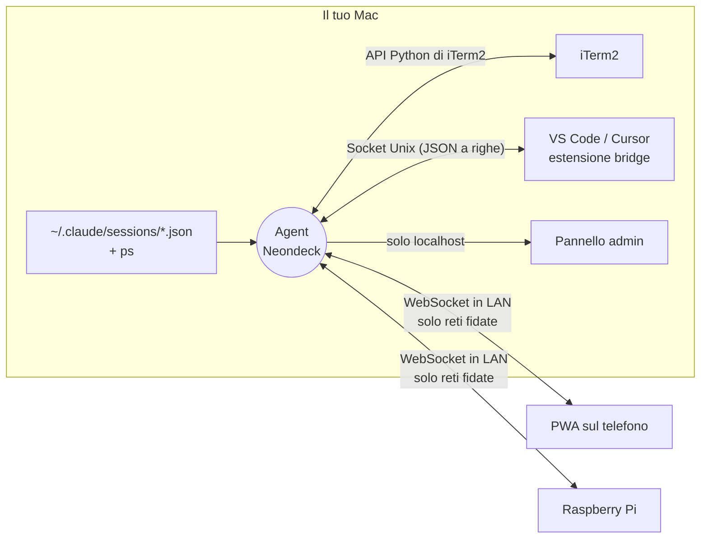

<p align="center">
  
</p>

<p align="center">
  <b>Un telecomando in stile Stream Deck per le tue sessioni Claude Code.</b><br>
  Vedi tutte le sessioni a colpo d'occhio, saltaci con un tocco e lancia i tuoi pulsanti dal telefono o da un Raspberry Pi.
</p>

<p align="center">
  <a href="LICENSE"></a>
  
  
  
  
</p>

<p align="center">
  <a href="README.md">🇬🇧 English</a> · <a href="https://matteofrige.github.io/neondeck/demo.html">Demo online</a> · <a href="CHANGELOG.md">Changelog</a>
</p>

---

Neondeck è un piccolo agent per macOS con un'interfaccia web pensata per il touch. Se usi molte sessioni [Claude Code](https://claude.com/claude-code) contemporaneamente, sparse tra finestre, schede e pannelli divisi di iTerm2 e terminali integrati di VS Code, le trasforma in una griglia di tessere sul telefono o su un piccolo schermo Raspberry Pi: quali stanno lavorando, quali aspettano te, quale è quale. Tocchi una tessera e quel terminale esatto passa in primo piano sul Mac. Poi usi una fila di pulsanti personalizzabili (invio tasti, comando shell, URL, salto a una sessione) per rispondere, interrompere, cambiare modalità o fare un deploy senza toccare la tastiera.

<p align="center">
  
  &nbsp;&nbsp;
  
</p>

> **Non affiliato ad Anthropic.** Neondeck è un progetto indipendente. Legge i file di sessione locali che scrive Claude Code e controlla i tuoi terminali; non comunica con nessun servizio Anthropic. Vedi [Licenza e avvertenze](#licenza-e-avvertenze).

## Funzionalità

- 🟢 **Griglia delle sessioni in tempo reale.** Una tessera per sessione con il suo stato: al lavoro (busy), inattiva o in attesa di te, oppure una semplice shell. Le tessere si aggiornano man mano.
- 👆 **Tocca per mettere a fuoco.** Porta in primo piano la finestra, la scheda *e* il pannello giusti in iTerm2, oppure il terminale giusto in VS Code.
- 🖥️ **Tutte le sessioni iTerm2, non solo Claude.** `zsh`, `vim`, `ssh`, `htop`... ogni pannello ha la sua tessera (si può disattivare).
- 🧩 **Terminali integrati di VS Code** tramite una minuscola estensione bridge (Cursor funziona in modalità best-effort).
- 🎛️ **Pulsanti Stream Deck personalizzati.** Invio tasti, comando shell, apertura di un URL o salto a una sessione per nome, con emoji o immagini caricate e colori opzionali.
- 📱 **PWA per il telefono con abbinamento via QR.** Scansioni una volta, aggiungi alla schermata Home, fatto.
- 🥧 **Dispositivo Raspberry Pi.** Layout per touch screen 800x480, pensato per un Pi Zero 2 W (vedi [Costruire il dispositivo Raspberry Pi](#costruire-il-dispositivo-raspberry-pi)).
- 🔒 **Sicurezza di default.** Il listener di rete esiste solo sulle reti fidate, una chiave admin protegge le impostazioni, i tentativi falliti sono limitati e un dispositivo può solo premere i pulsanti che hai definito (non può mai inviare testo o comandi arbitrari). Dettagli in [Sicurezza](#sicurezza).
- 🪶 **Impronta minima.** Circa 57 MB di RAM, praticamente zero CPU quando nessuno è collegato, e non tiene mai sveglio il Mac.

## Come funziona



L'agent legge i file di sessione che Claude Code tiene in `~/.claude/sessions`, risale l'albero dei processi con un solo `ps` per ciclo per capire quale terminale ospita ogni sessione, e chiede a iTerm2 (API Python) e al bridge di VS Code (socket Unix) di mettere a fuoco un terminale o di scriverci dentro. I dispositivi si collegano via WebSocket, ricevono lo stato completo a ogni cambiamento e rispondono con due tipi di richiesta: *metti a fuoco questa tessera* e *premi questo pulsante*.

## Requisiti

- macOS (l'agent usa `launchd`, `scutil`, `lsappinfo` e `open`).
- [uv](https://docs.astral.sh/uv/) per installarlo.
- iTerm2 con l'**API Python abilitata**: *iTerm2 › Settings › General › Magic › Enable Python API*. iTerm2 chiede l'autorizzazione alla prima connessione dell'agent.
- Facoltativo: VS Code e/o Cursor per il bridge dei terminali integrati.
- Un telefono o un Raspberry Pi sulla stessa rete Wi-Fi.

## Avvio rapido

```bash
uv tool install git+https://github.com/matteofrige/neondeck
neondeck install
neondeck qr
```

`neondeck install` crea il LaunchAgent (parte al login, log in `~/Library/Logs/neondeck.log`), installa l'estensione nei VS Code / Cursor che trova, marca come fidata la rete corrente se non ne hai ancora, e mostra l'indirizzo per il telefono con un QR code. Scansionalo dal telefono collegato alla stessa Wi-Fi.

> 💡 **Aggiungi alla schermata Home.** Su iPhone: Condividi › *Aggiungi alla schermata Home* (su Android: menu › *Installa app*). Si apre a schermo intero come un'app nativa. L'app installata ha una memoria separata da Safari: se chiede un token, incolla l'output di `neondeck token`.

Provalo senza installare nulla: la [demo online](https://matteofrige.github.io/neondeck/demo.html) esegue l'interfaccia con dati finti.

<details>
<summary><b>Aggiornamento, disinstallazione, passaggio da "Claude Deck"</b></summary>

```bash
uv tool upgrade neondeck && neondeck install      # aggiornamento
neondeck uninstall                                # conserva la configurazione
neondeck uninstall --purge                        # elimina anche ~/.config/neondeck
uv tool uninstall neondeck
```

Neondeck si chiamava *Claude Deck*. Al primo avvio, se `~/.config/neondeck` non esiste ma esiste `~/.config/claude-deck`, le impostazioni (`config.json`, `buttons.json`, `icons/`) vengono copiate con gli stessi permessi e la vecchia cartella resta dov'è. `neondeck install` rimuove anche il vecchio LaunchAgent e la vecchia estensione di VS Code. La variabile d'ambiente `CLAUDE_DECK_HOME` è ancora accettata come alternativa a `NEONDECK_HOME`. I telefoni abbinati prima del cambio di nome continuano a funzionare; i client Bonjour ora devono cercare `_neondeck._tcp`.

</details>

## Riferimento CLI

Esegui `neondeck` senza argomenti per avviare il server in primo piano (come `neondeck run`).

| Comando | Descrizione |
|---|---|
| `neondeck` / `neondeck run` | Avvia l'agent in primo piano. |
| `neondeck install [--no-vscode] [--no-launchd]` | Installa il LaunchAgent e l'estensione VS Code / Cursor, marca come fidata la rete corrente se non ce ne sono ancora, mostra il QR code. Rimuove anche il vecchio agent e la vecchia estensione *Claude Deck*. |
| `neondeck uninstall [--purge]` | Rimuove LaunchAgent ed estensione. `--purge` elimina anche la cartella dati. |
| `neondeck status` | Stato di LaunchAgent, server, listener LAN, Bonjour, rete fidata, socket del bridge ed estensione. |
| `neondeck restart` | Riavvia l'agent (`launchctl kickstart -k`). |
| `neondeck qr` | Stampa l'indirizzo per il telefono e un QR code. |
| `neondeck token [--rotate] [--admin]` | Stampa il token dei dispositivi (o la chiave admin con `--admin`); `--rotate` ne genera uno nuovo. |
| `neondeck trust [--name NOME]` | Marca la rete corrente come fidata. |
| `neondeck networks` | Elenca le reti fidate e segna quella corrente. |
| `neondeck untrust <MAC\|NOME\|N>` | Rimuove una rete fidata per MAC, nome o numero d'ordine. |
| `neondeck admin` | Apre il pannello admin nel browser (la chiave viaggia nel frammento dell'URL). |
| `neondeck vsix [-o PERCORSO]` | Crea il pacchetto `.vsix` dell'estensione VS Code. |
| `neondeck --version` | Stampa la versione. |

I comandi che modificano `config.json` (`trust`, `untrust`, `token --rotate`) sono letti dall'agent in esecuzione senza riavvio.

## Configurazione

Tutto sta in `~/.config/neondeck/` (modificabile con `NEONDECK_HOME`). La cartella è creata con permessi 700 e `config.json` con permessi 600.

<details>
<summary><b>Campi di <code>config.json</code></b></summary>

| Campo | Predefinito | Significato |
|---|---|---|
| `port` | `8787` | Porta HTTP / WebSocket. |
| `token` | generato | Segreto usato dai dispositivi (header `Authorization: Bearer`, oppure `?token=` sul WebSocket). |
| `admin_key` | generata | Segreto del pannello admin (`X-Admin-Key`). |
| `trusted_networks` | `[]` | Reti in cui il listener LAN è consentito: `{name, mac, subnet, added}`, identificate dal MAC del gateway. Si gestiscono con `neondeck trust` / `untrust` o dal pannello admin. |
| `bind` | non impostato | Imposta `127.0.0.1` per la modalità solo locale: il listener LAN non parte mai. |
| `show_all_iterm` | `true` | Mostra come tessera ogni sessione iTerm2, non solo quelle di Claude Code (è anche un'opzione nel pannello admin). |

</details>

<details>
<summary><b>Schema di <code>buttons.json</code> ed esempi</b></summary>

Un array di pulsanti. Ogni pulsante ha `id`, `title` (da 1 a 40 caratteri), `icon` (`{"type": "emoji", "value": "🚀"}` oppure `{"type": "image", "value": "icons/nome.png"}`), un `color` facoltativo (`#rrggbb`) e un'`action`. Il modo più semplice per modificarli è il pannello admin (`neondeck admin`), che carica anche le immagini (png, jpg, gif, webp o svg, fino a 2 MB) in `icons/`.

Al primo avvio vengono creati quattro pulsanti: Esc, Invio, Interrompi (Ctrl+C) e Cambia modalità (Shift+Tab).

```json
[
  {
    "id": "enter",
    "title": "Invio",
    "icon": { "type": "emoji", "value": "↵" },
    "action": { "type": "send_keys", "text": "\r", "target": "current" }
  },
  {
    "id": "deploy",
    "title": "Deploy",
    "icon": { "type": "emoji", "value": "🚀" },
    "color": "#ff3cc7",
    "action": { "type": "shell", "command": "./deploy.sh", "timeout": 60 }
  },
  {
    "id": "docs",
    "title": "Docs",
    "icon": { "type": "image", "value": "icons/docs.png" },
    "action": { "type": "open_url", "url": "https://example.com/docs" }
  },
  {
    "id": "jump-infra",
    "title": "Infra",
    "icon": { "type": "emoji", "value": "🏗️" },
    "action": { "type": "focus_session", "match": "infra" }
  }
]
```

| Azione | Campi | Comportamento |
|---|---|---|
| `send_keys` | `text`, `target` = `current` o `selected` | Scrive il testo in una sessione, senza premere Invio a meno che `text` contenga `\r`. `current` è la sessione in primo piano (iTerm2 frontmost, oppure il terminale attivo della finestra VS Code a fuoco), con ripiego sull'ultima tessera messa a fuoco da un dispositivo; `selected` è la tessera selezionata sul dispositivo. |
| `shell` | `command`, `timeout` (da 1 a 600 s, predefinito 10) | Esegue `/bin/zsh -lc <comando>` sul Mac e riporta il codice di uscita e gli ultimi 500 caratteri di output. |
| `open_url` | `url` (serve uno schema) | Esegue `open <url>`. |
| `focus_session` | `match` | Mette a fuoco la prima sessione il cui nome o progetto contiene il testo. Funziona anche sulle tessere dei terminali. |

</details>

## Le tessere delle sessioni

<details open>
<summary><b>Come leggere la griglia</b></summary>

- **Colore di stato.** Ambra e pulsante = *busy* (Claude sta lavorando). Verde = *idle* (aspetta te). Blu = una semplice *shell*. Le tessere dei terminali (sessioni iTerm2 non Claude) sono ciano e attenuate finché non hanno il fuoco.
- **Contorni.** Un contorno bianco sottile segna la sessione attualmente in primo piano sul Mac; uno spesso segna la tessera selezionata sul dispositivo (la destinazione dei pulsanti `selected`).
- **Badge dell'host.** `iT` = iTerm2, `VS` = VS Code / Cursor, seguito dall'etichetta di posizione.
- **Etichetta di posizione.** `F1·T2` = finestra 1, scheda 2; `F1·T2·P2` aggiunge il pannello 2 quando la scheda è divisa. Le finestre seguono l'ordine di iTerm2.
- **Sottotitolo.** Il tempo nello stato corrente per le tessere Claude («da 3 min»); la cartella corrente o la posizione per i terminali.
- **Tessere non comandabili.** Le sessioni in un terminale che l'agent non può pilotare (Terminal.app, Ghostty, una finestra VS Code senza bridge, ...) sono attenuate, mostrano «non comandabile» e non si possono selezionare.
- **Ordine.** Prima le sessioni Claude comandabili, poi i terminali per finestra / scheda / pannello, in fondo le sessioni non comandabili. Se una sessione iTerm2 esegue una sessione Claude Code, compare solo la tessera Claude.

</details>

## Bridge VS Code

VS Code non ha un'API esterna per il terminale integrato, quindi `neondeck install` installa una piccola estensione (JavaScript semplice, senza dipendenze né build; `src/neondeck/vscode_bridge/`). Comunica il PID della shell di ogni terminale tramite un socket Unix in `<NEONDECK_HOME>/bridge.sock` (permessi 600 in una cartella 700: nessuna rete, nessun token). L'agent associa una sessione Claude Code a un terminale quando la shell di quel terminale è fra i processi padre della sessione, poi chiede all'estensione di mostrare il terminale o di scriverci dentro. Le richieste scadono dopo 3 secondi.

Dopo l'installazione esegui **Developer: Reload Window** in ogni finestra dell'editor. L'estensione scrive nel pannello Output **Neondeck** e il comando **Neondeck: riconnetti** forza la riconnessione (riprova comunque da sola ogni 1-15 secondi). Senza CLI, esegui `neondeck vsix` e usa *Extensions: Install from VSIX...*.

Limiti:

- L'API delle estensioni non può portare in primo piano la finestra: dopo aver messo a fuoco il terminale l'agent lancia la CLI dell'editor sulla cartella dell'area di lavoro (oppure `open -a` se non c'è). Con più finestre sulla stessa cartella potrebbe salire quella sbagliata. Imposta `NEONDECK_NO_RAISE=1` per saltare questo passo.
- Cursor è best-effort (stessa estensione, CLI `cursor`).
- Le finestre remote (SSH, container, WSL) non sono supportate.

## Sicurezza

Neondeck permette a un dispositivo di premere tasti nei tuoi terminali, quindi è costruito per essere raggiungibile da meno cose possibile.

| Chi | Cosa può tentare | Difesa |
|---|---|---|
| Qualcuno sulla **tua Wi-Fi fidata** | Intercettare o indovinare il token, poi elencare le sessioni e premere i tuoi pulsanti | Il token è di 24 byte casuali; 5 token errati in 10 minuti bloccano l'IP per 10 minuti (429 / codice di chiusura 4429); il dispositivo può solo premere pulsanti predefiniti, mai inviare testo libero o comandi; i pulsanti shell si definiscono solo dal pannello admin. Ruota con `neondeck token --rotate`. |
| Qualcuno su una **Wi-Fi pubblica o non fidata** | Raggiungere l'agent | Non c'è nulla da raggiungere: l'agent ascolta solo sul loopback e apre il listener LAN solo mentre il Mac è su una rete fidata (identificata dal MAC del gateway). Quando la rete cambia il socket viene chiuso, i client ricevono il codice 4403 e Bonjour viene ritirato. Le richieste sono respinte anche se il MAC del gateway non è determinabile (fail closed) o se l'IP del client è fuori dalla sottorete del Mac. |
| Un **processo o utente locale** sul Mac | Leggere il token, parlare con il bridge | `config.json` ha permessi 600 in una cartella 700; il socket del bridge è raggiungibile solo dal tuo utente. Qualunque cosa giri come te può comunque leggere i tuoi file. |
| Un **sito web malevolo** nel browser | Colpire `localhost:8787` (CSRF, DNS rebinding) per usare il pannello admin | `/api/admin/*` richiede l'header `X-Admin-Key` (mai inviato da una semplice richiesta cross-site), l'admin è solo localhost giudicato dall'indirizzo del socket (mai `X-Forwarded-For`), e `Host` / `Origin` sono controllati contro il DNS rebinding. |

Altri dettagli: le icone sono limitate a 2 MB e a tipi immagine, e gli SVG sono serviti con `Content-Security-Policy: default-src 'none'`. Connessioni, token errati, blocchi e reti respinte finiscono nel log.

**Sii onesto sui limiti.**

- Il traffico fra dispositivo e Mac è **HTTP in chiaro** nella tua LAN. Chi può intercettare quella rete può leggere il token. Per questo il listener gira solo sulle reti che marchi esplicitamente come fidate.
- Un pulsante che invia **Invio può approvare una richiesta di permesso di Claude Code**. Chiunque abbia il token può farlo. Tratta il token come una password.

Consigli:

- Ruota il token se è stato condiviso o visto da altri: `neondeck token --rotate`.
- Non fidarti mai di reti pubbliche (bar, hotel, coworking, hotspot condivisi).
- Su una rete fidata ma non davvero tua, attiva la modalità invisibile (*stealth*) del firewall di macOS (Impostazioni di Sistema › Rete › Firewall › Opzioni).
- Per usare solo l'anteprima sul Mac, imposta `"bind": "127.0.0.1"` in `config.json`.

## Note su macOS

- Il **permesso Rete locale** serve solo per gli annunci **Bonjour** (auto-discovery da parte del Pi). Il riconoscimento della rete (MAC del gateway, IP, sottorete) legge configd tramite `scutil`, che macOS non filtra, quindi `neondeck trust` funziona anche con il Python gestito da uv. Solo se configd non fornisce il MAC del gateway l'agent ripiega su `route` / `arp`, che le versioni recenti di macOS filtrano per i binari senza permesso (in quel caso `neondeck status` mostra `localnet_permission`). Senza permesso il listener LAN parte comunque e i dispositivi si collegano tramite IP.
  Per abilitare Bonjour: Impostazioni di Sistema › Privacy e sicurezza › **Rete locale** › abilita il binario Python indicato nel messaggio di log, poi `neondeck restart`. Dopo un aggiornamento di Python tramite uv il percorso del binario cambia e il permesso va concesso di nuovo.
- **Avvii in sandbox.** Se esegui Neondeck dentro la sandbox `!` di Claude Code, `ps` è bloccato: l'agent non legge i processi e l'interfaccia mostra «Processi non leggibili». Avvialo da un terminale normale o con `neondeck install`.
- L'agent non impedisce mai la sospensione e gira senza problemi come LaunchAgent nella tua sessione di login.

## Risorse

Misurato: circa **57 MB di RSS** e circa **0,6% di CPU** con un client collegato, circa 0 a riposo. Senza client collegati l'agent non fa nulla: nessun polling, nessun `ps`, nessun `lsappinfo`, nessuna scansione di iTerm2; si aggiorna subito alla prima connessione. L'unico timer sempre attivo è il controllo di rete ogni 30 secondi. Con client collegati `lsappinfo` viene eseguito al più ogni 2 secondi e solo se esiste una sessione iTerm2 / VS Code; i dettagli di iTerm2 si leggono una volta per sessione nuova e poi solo quando iTerm2 notifica un cambio. Non tiene alcuna asserzione di alimentazione, quindi non impedisce al Mac di andare in stop.

## Costruire il dispositivo Raspberry Pi

Il layout di `/preview` è pensato per uno schermo 800x480. Hardware consigliato:

- **Raspberry Pi Zero 2 W**, piccolo, economico, con Wi-Fi integrato.
- **Pimoroni HyperPixel 4.0 Touch** (800x480, touch capacitivo, si innesta sull'header GPIO). Lo Zero non ha il connettore DSI, ed è per questo che qui un display DSI ufficiale non è un'opzione.
- Scheda batteria **PiSugar 3 Plus 5000 mAh**.
- Una microSD.

Se preferisci i display DSI, un Compute Module 4 su una carrier adatta è un'alternativa.

**Stato: il client nativo è in lavorazione.** Nel frattempo puoi usare Chromium in modalità kiosk su un Pi 4 o 5 puntato su `http://<ip-del-mac>:8787/preview?token=...&frame=1`, oppure semplicemente il telefono. `frame=1` forza il layout fisso 800x480.

## Riferimento del protocollo WebSocket

Tutti gli endpoint per i dispositivi richiedono una rete fidata e il token (`Authorization: Bearer <token>`, oppure `?token=` sul WebSocket).

<details>
<summary><b>Endpoint HTTP</b></summary>

| Metodo | Percorso | Descrizione |
|---|---|---|
| GET | `/api/sessions` | `{"sessions": [...], "iterm": bool}` |
| GET | `/api/buttons` | `{"buttons": [...]}` |
| POST | `/api/focus` `{"id"}` o `{"pid"}` | Mette a fuoco una tessera (`id` è `claude:<pid>` o `iterm:<sessione>`; `pid` solo per le sessioni Claude). |
| POST | `/api/press` `{"id", "target_id"?, "pid"?}` | Preme un pulsante; `target_id` è la tessera selezionata sul dispositivo. Risposta `{"ok", "detail"}`. |
| WS | `/ws?token=...` | Vedi sotto. |
| GET | `/preview` | Web app telecomando / simulatore (`?frame=1` fisso 800x480, `?demo=1` dati finti). |
| GET | `/icons/<file>` | Icone dei pulsanti (senza token). |

</details>

<details>
<summary><b>Messaggi WebSocket</b></summary>

Dal server al client:

- `{"type": "state", "sessions": [...], "buttons": [...], "iterm": bool}`: inviato alla connessione e a ogni cambiamento.
- `{"type": "result", "ok": bool, "detail": str, "req": any}`: risposta a `focus` / `press`; `req` è restituito identico.
- `{"type": "pong"}`.

Dal client al server:

- `{"type": "focus", "id": "claude:123"}` (o `"pid"`).
- `{"type": "press", "id": "<id pulsante>", "target_id"?: "<id tessera>", "pid"?: n}`.
- `{"type": "ping"}`.

Codici di chiusura applicativi: **4401** token errato, **4403** rete non fidata, **4429** troppi tentativi.

Una tessera di sessione ha: `kind` (`claude` o `terminal`), `id`, `pid` (null per i terminali), `sessionId`, `name`, `cwd`, `project`, `status` (`busy`, `idle`, `shell`, `terminal`, ...), `statusSince` (ms), `startedAt`, `tty`, `host` (`iterm`, `vscode`, `other`), `loc`, `controllable`, `focused`; le tessere dei terminali hanno anche `title` e `itermSession`.

Scoperta: servizio Bonjour `_neondeck._tcp.local.` sulla porta dell'agent, TXT `v=1` (il token non è mai annunciato).

</details>

## Sviluppo

```bash
uv sync
uv run neondeck run          # avvia l'agent dal checkout (senza LaunchAgent)
uv run pytest                # test
uv run neondeck vsix -o .    # crea il pacchetto dell'estensione VS Code
```

- **Modalità demo.** Apri `/preview?demo=1` su un agent in esecuzione, oppure `docs/demo.html` direttamente da disco: l'interfaccia mostra sessioni e pulsanti finti, senza WebSocket e senza token. `docs/demo.html` è generato da `src/neondeck/static/preview.html` con `python scripts/build_demo.py` (un test verifica che sia aggiornato) e può essere ospitato in modo statico, per esempio con GitHub Pages.
- **Risorse grafiche.** `python scripts/build_assets.py` rigenera `docs/assets/logo.svg` e `banner.svg`. Gli screenshot (`screenshot-landscape.png` 800x480, `screenshot-phone.png` 390x844) si ricavano dalla demo con Chrome headless.

## Roadmap

- Client nativo per Raspberry Pi (LVGL o pygame) al posto del browser
- Supporto a Terminal.app e Ghostty
- Token per singolo dispositivo
- Tap Homebrew
- App nella barra dei menu
- Interfaccia tradotta (oggi è in italiano)

## Risoluzione dei problemi

<details>
<summary><b>Una tessera è grigia e dice «non comandabile»</b></summary>

La sessione gira in un terminale che l'agent non può pilotare (qualunque cosa diversa da iTerm2 o VS Code / Cursor), oppure in una finestra VS Code dove il bridge non è collegato. Per VS Code: esegui *Developer: Reload Window*, poi controlla il pannello Output **Neondeck** e `neondeck status` (socket del bridge ed estensione). Le finestre remote di VS Code non sono supportate.

</details>

<details>
<summary><b>«Processi non leggibili» nell'intestazione</b></summary>

L'agent non è riuscito a eseguire `ps`. Succede quando parte dentro una sandbox (per esempio quella `!` di Claude Code). Avvialo con `neondeck install` o da un terminale normale.

</details>

<details>
<summary><b>Il telefono non si collega</b></summary>

Controlla in quest'ordine: telefono e Mac sono sulla stessa Wi-Fi; quella rete è fidata (`neondeck networks`, poi `neondeck trust` da quella rete); l'agent è in esecuzione (`neondeck status`); il token è quello attuale (`neondeck token`). Una schermata «Rete non fidata» corrisponde al codice 4403; «Troppi tentativi» significa 5 token errati e un blocco di 10 minuti.

</details>

<details>
<summary><b>iTerm2 risulta non disponibile</b></summary>

Abilita *iTerm2 › Settings › General › Magic › Enable Python API* e accetta la richiesta di autorizzazione. L'agent si riconnette da solo; nel frattempo l'elenco delle sessioni continua a funzionare.

</details>

<details>
<summary><b>Bonjour non è attivo</b></summary>

Concedi il permesso Rete locale al binario Python (vedi [Note su macOS](#note-su-macos)). È facoltativo: i dispositivi possono sempre collegarsi tramite IP.

</details>

## Licenza e avvertenze

[MIT](LICENSE) © 2026 Matteo Frigé.

Neondeck è un progetto indipendente, non affiliato né approvato da Anthropic. Claude e Claude Code sono marchi di Anthropic. La mascotte e tutta la grafica di questo repository sono originali.
