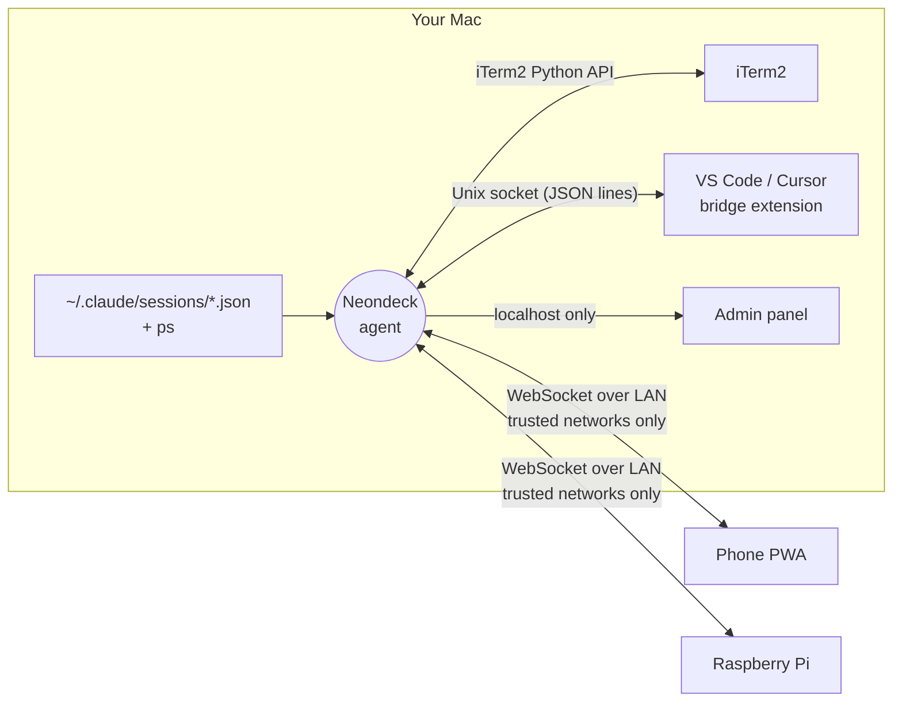

<p align="center">
  
</p>

<p align="center">
  <b>A Stream Deck-style remote for your Claude Code sessions.</b><br>
  See every session at a glance, jump to it with one tap, and fire your own buttons from a phone or a Raspberry Pi.
</p>

<p align="center">
  <a href="LICENSE"></a>
  
  
  
  
</p>

<p align="center">
  <a href="README.it.md">🇮🇹 Italiano</a> · <a href="https://matteofrige.github.io/neondeck/demo.html">Live demo</a> · <a href="CHANGELOG.md">Changelog</a>
</p>

---

Neondeck is a small macOS agent plus a touch-friendly web UI. If you run many [Claude Code](https://claude.com/claude-code) sessions at once, spread over iTerm2 windows, tabs, split panes and VS Code integrated terminals, it turns them into a grid of tiles on your phone or on a small Raspberry Pi screen: which ones are working, which ones are waiting for you, which one is which. Tap a tile and that exact terminal comes to the front on your Mac. Then use a row of customizable buttons (send keys, run a shell command, open a URL, jump to a session) to answer, interrupt, switch mode or deploy without touching the keyboard.

<p align="center">
  
  &nbsp;&nbsp;
  
</p>

> **Not affiliated with Anthropic.** Neondeck is an independent project. It reads the local session files that Claude Code writes and controls your terminals; it does not talk to any Anthropic service. See [License and disclaimer](#license-and-disclaimer).

## Features

- 🟢 **Live session grid.** One tile per session with its status: working (busy), idle or waiting for you, or a plain shell. Tiles update as things happen.
- 👆 **Tap to focus.** Brings the right window, tab *and* split pane to the front in iTerm2, or the right terminal in VS Code.
- 🖥️ **Every iTerm2 session, not only Claude.** `zsh`, `vim`, `ssh`, `htop`... each pane gets a tile (can be switched off).
- 🧩 **VS Code integrated terminals** through a tiny bridge extension (Cursor works best-effort).
- 🎛️ **Custom Stream Deck buttons.** Send keys, run a shell command, open a URL or jump to a session by name, with emoji or uploaded images and optional colors.
- 📱 **Phone PWA with QR pairing.** Scan once, add it to your Home Screen, done.
- 🥧 **Raspberry Pi device.** An 800x480 touch screen layout, designed for a Pi Zero 2 W (see [Building the Raspberry Pi device](#building-the-raspberry-pi-device)).
- 🔒 **Security by default.** The network listener only exists on networks you trust, an admin key protects the settings, failed logins are throttled, and a device can only press buttons you defined (it can never send arbitrary text or commands). Details in [Security](#security).
- 🪶 **Tiny footprint.** About 57 MB of RAM, essentially zero CPU when nobody is connected, and it never keeps your Mac awake.

## How it works



The agent reads the session files that Claude Code keeps in `~/.claude/sessions`, walks the process tree with a single `ps` per cycle to find which terminal hosts each session, and asks iTerm2 (Python API) and the VS Code bridge (Unix socket) to focus a terminal or type into it. Devices connect over a WebSocket, receive the full state on every change and send back two kinds of requests: *focus this tile* and *press this button*.

## Requirements

- macOS (the agent uses `launchd`, `scutil`, `lsappinfo` and `open`).
- [uv](https://docs.astral.sh/uv/) to install it.
- iTerm2 with the **Python API enabled**: *iTerm2 › Settings › General › Magic › Enable Python API*. iTerm2 asks for permission the first time the agent connects.
- Optional: VS Code and/or Cursor for the integrated terminal bridge.
- A phone or a Raspberry Pi on the same Wi-Fi network.

## Quick start

```bash
uv tool install git+https://github.com/matteofrige/neondeck
neondeck install
neondeck qr
```

`neondeck install` creates the LaunchAgent (starts at login, log in `~/Library/Logs/neondeck.log`), installs the extension into the VS Code / Cursor builds it finds, marks the current network as trusted if you have none yet, and prints the phone address with a QR code. Scan it with your phone while on the same Wi-Fi.

> 💡 **Add to Home Screen.** On iPhone: Share › *Add to Home Screen* (on Android: menu › *Install app*). It opens full screen like a native app. The installed app has its own storage, separate from Safari: if it asks for a token, paste the output of `neondeck token`.

Try it without installing anything: the [live demo](https://matteofrige.github.io/neondeck/demo.html) runs the UI with fake data.

<details>
<summary><b>Update, uninstall, upgrading from "Claude Deck"</b></summary>

```bash
uv tool upgrade neondeck && neondeck install      # update
neondeck uninstall                                # keeps your settings
neondeck uninstall --purge                        # also deletes ~/.config/neondeck
uv tool uninstall neondeck
```

Neondeck used to be called *Claude Deck*. On first run, if `~/.config/neondeck` does not exist but `~/.config/claude-deck` does, the settings (`config.json`, `buttons.json`, `icons/`) are copied over with the same permissions and the old directory is left in place. `neondeck install` also removes the old LaunchAgent and the old VS Code extension. The `CLAUDE_DECK_HOME` environment variable is still honored as a fallback for `NEONDECK_HOME`. Phones paired before the rename keep working; Bonjour clients must now look for `_neondeck._tcp`.

</details>

## CLI reference

Run `neondeck` with no arguments to start the server in the foreground (same as `neondeck run`).

| Command | Description |
|---|---|
| `neondeck` / `neondeck run` | Run the agent in the foreground. |
| `neondeck install [--no-vscode] [--no-launchd]` | Install the LaunchAgent and the VS Code / Cursor extension, trust the current network if none is trusted yet, show the QR code. Also removes the legacy *Claude Deck* agent and extension. |
| `neondeck uninstall [--purge]` | Remove the LaunchAgent and the extension. `--purge` also deletes the data directory. |
| `neondeck status` | LaunchAgent, server, LAN listener, Bonjour, network trust, bridge socket and extension status. |
| `neondeck restart` | Restart the agent (`launchctl kickstart -k`). |
| `neondeck qr` | Print the phone address and a QR code. |
| `neondeck token [--rotate] [--admin]` | Print the device token (or the admin key with `--admin`); `--rotate` generates a new one. |
| `neondeck trust [--name NAME]` | Mark the current network as trusted. |
| `neondeck networks` | List trusted networks and mark the current one. |
| `neondeck untrust <MAC\|NAME\|N>` | Remove a trusted network by MAC address, name or list number. |
| `neondeck admin` | Open the admin panel in your browser (the key is passed in the URL fragment). |
| `neondeck vsix [-o PATH]` | Build the `.vsix` package of the VS Code extension. |
| `neondeck --version` | Print the version. |

Commands that edit `config.json` (`trust`, `untrust`, `token --rotate`) are picked up by the running agent without a restart.

## Configuration

Everything lives in `~/.config/neondeck/` (override with `NEONDECK_HOME`). The directory is created with mode 700 and `config.json` with mode 600.

<details>
<summary><b><code>config.json</code> fields</b></summary>

| Field | Default | Meaning |
|---|---|---|
| `port` | `8787` | HTTP / WebSocket port. |
| `token` | generated | Secret used by devices (header `Authorization: Bearer`, or `?token=` on the WebSocket). |
| `admin_key` | generated | Secret for the admin panel (`X-Admin-Key`). |
| `trusted_networks` | `[]` | Networks where the LAN listener is allowed: `{name, mac, subnet, added}`, identified by the gateway's MAC address. Manage with `neondeck trust` / `untrust` or from the admin panel. |
| `bind` | unset | Set to `127.0.0.1` for local-only mode: the LAN listener never starts. |
| `show_all_iterm` | `true` | Show every iTerm2 session as a tile, not only Claude Code ones (also a toggle in the admin panel). |

</details>

<details>
<summary><b><code>buttons.json</code> schema and examples</b></summary>

An array of buttons. Every button has `id`, `title` (1 to 40 characters), `icon` (`{"type": "emoji", "value": "🚀"}` or `{"type": "image", "value": "icons/name.png"}`), an optional `color` (`#rrggbb`) and an `action`. The easiest way to edit them is the admin panel (`neondeck admin`), which also uploads images (png, jpg, gif, webp or svg, up to 2 MB) into `icons/`.

The first run creates four buttons: Esc, Enter, Interrupt (Ctrl+C) and Switch mode (Shift+Tab).

```json
[
  {
    "id": "enter",
    "title": "Invio",
    "icon": { "type": "emoji", "value": "↵" },
    "action": { "type": "send_keys", "text": "\r", "target": "current" }
  },
  {
    "id": "deploy",
    "title": "Deploy",
    "icon": { "type": "emoji", "value": "🚀" },
    "color": "#ff3cc7",
    "action": { "type": "shell", "command": "./deploy.sh", "timeout": 60 }
  },
  {
    "id": "docs",
    "title": "Docs",
    "icon": { "type": "image", "value": "icons/docs.png" },
    "action": { "type": "open_url", "url": "https://example.com/docs" }
  },
  {
    "id": "jump-infra",
    "title": "Infra",
    "icon": { "type": "emoji", "value": "🏗️" },
    "action": { "type": "focus_session", "match": "infra" }
  }
]
```

| Action | Fields | Behavior |
|---|---|---|
| `send_keys` | `text`, `target` = `current` or `selected` | Types the text into a session, without pressing Enter unless `text` contains `\r`. `current` is the session in front (frontmost iTerm2, or the active terminal of the focused VS Code window), falling back to the last tile focused from a device; `selected` is the tile selected on the device. |
| `shell` | `command`, `timeout` (1 to 600 s, default 10) | Runs `/bin/zsh -lc <command>` on the Mac and reports the exit code and the last 500 characters of output. |
| `open_url` | `url` (needs a scheme) | Runs `open <url>`. |
| `focus_session` | `match` | Focuses the first session whose name or project contains the text. Works on terminal tiles too. |

</details>

## Session tiles

<details open>
<summary><b>Reading the grid</b></summary>

- **Status color.** Amber and pulsing = *busy* (Claude is working). Green = *idle* (waiting for you). Blue = a plain *shell*. Terminal tiles (non-Claude iTerm2 sessions) are cyan and dimmed until focused.
- **Outlines.** A thin white outline marks the session currently in front on the Mac; a thick one marks the tile you selected on the device (the target of `selected` buttons).
- **Host badge.** `iT` = iTerm2, `VS` = VS Code / Cursor. It is followed by the location label.
- **Location label.** `F1·T2` = window 1, tab 2; `F1·T2·P2` adds pane 2 when the tab is split. Windows follow iTerm2's own order.
- **Subtitle.** Time in the current status for Claude tiles ("3 min"); the current folder or location for terminals.
- **Non-controllable tiles.** Sessions running in a terminal the agent cannot drive (Terminal.app, Ghostty, a VS Code window without the bridge, ...) are dimmed, show "non comandabile" and cannot be selected.
- **Order.** Controllable Claude sessions first, then terminals by window / tab / pane, non-controllable sessions last. If an iTerm2 session runs a Claude Code session, only the Claude tile is shown.

</details>

## VS Code bridge

VS Code has no external API for its integrated terminal, so `neondeck install` installs a small extension (plain JavaScript, no dependencies, no build step; `src/neondeck/vscode_bridge/`). It reports every terminal's shell PID over a Unix socket at `<NEONDECK_HOME>/bridge.sock` (mode 600 inside a mode 700 directory: no network, no token). The agent matches a Claude Code session to a terminal when that terminal's shell is among the session's parent processes, and then asks the extension to show the terminal or type into it. Requests time out after 3 seconds.

After installing, run **Developer: Reload Window** in each editor window. The extension logs to the **Neondeck** Output channel, and the **Neondeck: riconnetti** command forces a reconnect (it also retries by itself every 1 to 15 seconds). Without a CLI, run `neondeck vsix` and use *Extensions: Install from VSIX...*.

Limitations:

- The extension API cannot raise a window, so after focusing the terminal the agent runs the editor's CLI on the workspace folder (or `open -a` when there is none). With several windows on the same folder, the wrong one may come to the front. Set `NEONDECK_NO_RAISE=1` to skip this step.
- Cursor is best-effort (same extension, `cursor` CLI).
- Remote windows (SSH, containers, WSL) are not supported.

## Security

Neondeck lets a device press keys in your terminals, so it is built to be reachable by as few things as possible.

| Who | What they can try | Mitigation |
|---|---|---|
| Someone on **your trusted Wi-Fi** | Sniff or guess the token, then list sessions and press your buttons | Token is 24 random bytes; 5 wrong tokens in 10 minutes block the IP for 10 minutes (429 / close code 4429); the device can only press predefined buttons, never send free text or commands; shell buttons can only be defined from the admin panel. Rotate with `neondeck token --rotate`. |
| Someone on **public or untrusted Wi-Fi** | Reach the agent | There is nothing to reach: the agent only listens on loopback, and opens the LAN listener while the Mac is on a trusted network (identified by the gateway MAC). When the network changes the socket is closed, clients get close code 4403 and Bonjour is withdrawn. Requests are also refused if the gateway MAC cannot be determined (fail closed) or the client IP is outside the Mac's subnet. |
| A **local process or user** on your Mac | Read the token, talk to the bridge | `config.json` is mode 600 in a mode 700 directory; the bridge socket is only reachable by your user. Anything running as you can read your files anyway. |
| A **malicious website** in your browser | Hit `localhost:8787` (CSRF, DNS rebinding) to use the admin panel | `/api/admin/*` needs the `X-Admin-Key` header (never sent by a simple cross-site request), the admin is localhost-only judged on the socket address (never `X-Forwarded-For`), and `Host` / `Origin` are checked against DNS rebinding. |

Other details: icons are limited to 2 MB and to image types, and SVGs are served with `Content-Security-Policy: default-src 'none'`. Connections, wrong tokens, blocks and refused networks are logged.

**Be honest about the limits.**

- Traffic between the device and the Mac is **plain HTTP** on your LAN. Anyone who can sniff that network can read the token. That is why the listener only runs on networks you explicitly trust.
- A button that sends **Enter can approve a Claude Code permission prompt**. Anybody holding the token can do that. Treat the token like a password.

Recommendations:

- Rotate the token if it was shared or seen: `neondeck token --rotate`.
- Never trust public networks (cafes, hotels, coworkings, shared hotspots).
- On a trusted network that is not really yours, turn on the macOS firewall *stealth mode* (System Settings › Network › Firewall › Options).
- For preview-only use on the Mac, set `"bind": "127.0.0.1"` in `config.json`.

## macOS notes

- **Local Network permission** is only needed for **Bonjour** announcements (auto-discovery by the Pi). Network detection (gateway MAC, IP, subnet) reads configd through `scutil`, which macOS does not filter, so `neondeck trust` works even with uv's managed Python. Only if configd gives no gateway MAC does the agent fall back to `route` / `arp`, which recent macOS versions filter for binaries without the permission (`neondeck status` then shows `localnet_permission`). Without the permission the LAN listener still starts and devices connect by IP.
  To enable Bonjour: System Settings › Privacy & Security › **Local Network** › enable the Python binary named in the log message, then `neondeck restart`. After a uv Python upgrade the binary path changes and the permission must be granted again.
- **Sandboxed launches.** If you run Neondeck from inside Claude Code's `!` sandbox, `ps` is blocked: the agent cannot read processes and the UI shows "Processi non leggibili". Run it from a normal terminal or through `neondeck install`.
- The agent never prevents sleep and runs fine as a LaunchAgent in your login session.

## Resource usage

Measured: about **57 MB RSS** and about **0.6% CPU** with one client connected, and about 0 when idle. With no client connected the agent does nothing: no polling, no `ps`, no `lsappinfo`, no iTerm2 scans; it refreshes immediately when the first client connects. The only always-on timer is the network check every 30 seconds. With clients connected, `lsappinfo` runs at most every 2 seconds and only if an iTerm2 / VS Code session exists; iTerm2 details are read once per new session and then only when iTerm2 notifies a change. It does not hold a power assertion, so it does not keep the Mac awake.

## Building the Raspberry Pi device

The layout in `/preview` is designed for an 800x480 screen. Suggested hardware:

- **Raspberry Pi Zero 2 W**, small, cheap, Wi-Fi onboard.
- **Pimoroni HyperPixel 4.0 Touch** (800x480, capacitive touch, plugs on the GPIO header). The Zero has no DSI connector, which is why an official DSI display is not an option here.
- **PiSugar 3 Plus 5000 mAh** battery board.
- A microSD card.

If you prefer DSI displays, a Compute Module 4 on a suitable carrier is an alternative.

**Status: the native client is work in progress.** Until then, either run Chromium in kiosk mode on a Pi 4 or 5 pointed at `http://<mac-ip>:8787/preview?token=...&frame=1`, or just use your phone. `frame=1` forces the fixed 800x480 layout.

## WebSocket protocol reference

All device endpoints require a trusted network and the token (`Authorization: Bearer <token>`, or `?token=` on the WebSocket).

<details>
<summary><b>HTTP endpoints</b></summary>

| Method | Path | Description |
|---|---|---|
| GET | `/api/sessions` | `{"sessions": [...], "iterm": bool}` |
| GET | `/api/buttons` | `{"buttons": [...]}` |
| POST | `/api/focus` `{"id"}` or `{"pid"}` | Focus a tile (`id` is `claude:<pid>` or `iterm:<session>`; `pid` only for Claude sessions). |
| POST | `/api/press` `{"id", "target_id"?, "pid"?}` | Press a button; `target_id` is the tile selected on the device. Returns `{"ok", "detail"}`. |
| WS | `/ws?token=...` | See below. |
| GET | `/preview` | Remote / simulator web app (`?frame=1` fixed 800x480, `?demo=1` fake data). |
| GET | `/icons/<file>` | Button icons (no token). |

</details>

<details>
<summary><b>WebSocket messages</b></summary>

Server to client:

- `{"type": "state", "sessions": [...], "buttons": [...], "iterm": bool}`: sent on connect and on every change.
- `{"type": "result", "ok": bool, "detail": str, "req": any}`: reply to `focus` / `press`; `req` is echoed back unchanged.
- `{"type": "pong"}`.

Client to server:

- `{"type": "focus", "id": "claude:123"}` (or `"pid"`).
- `{"type": "press", "id": "<button id>", "target_id"?: "<tile id>", "pid"?: n}`.
- `{"type": "ping"}`.

Application close codes: **4401** wrong token, **4403** untrusted network, **4429** too many attempts.

A session tile has: `kind` (`claude` or `terminal`), `id`, `pid` (null for terminals), `sessionId`, `name`, `cwd`, `project`, `status` (`busy`, `idle`, `shell`, `terminal`, ...), `statusSince` (ms), `startedAt`, `tty`, `host` (`iterm`, `vscode`, `other`), `loc`, `controllable`, `focused`; terminal tiles also have `title` and `itermSession`.

Discovery: Bonjour service `_neondeck._tcp.local.` on the agent's port, TXT `v=1` (the token is never announced).

</details>

## Development

```bash
uv sync
uv run neondeck run          # run the agent from the checkout (no LaunchAgent)
uv run pytest                # tests
uv run neondeck vsix -o .    # build the VS Code extension package
```

- **Demo mode.** Open `/preview?demo=1` on a running agent, or `docs/demo.html` straight from disk: the UI shows fake sessions and buttons, with no WebSocket and no token. `docs/demo.html` is generated from `src/neondeck/static/preview.html` by `python scripts/build_demo.py` (a test checks that it is up to date) and can be hosted statically, for example with GitHub Pages.
- **Assets.** `python scripts/build_assets.py` regenerates `docs/assets/logo.svg` and `banner.svg`. The screenshots (`screenshot-landscape.png` 800x480, `screenshot-phone.png` 390x844) are taken from the demo with headless Chrome.

## Roadmap

- Native Raspberry Pi client (LVGL or pygame) instead of a browser
- Terminal.app and Ghostty support
- Per-device tokens
- Homebrew tap
- Menu bar app
- Translated UI (it is currently Italian)

## Troubleshooting

<details>
<summary><b>A tile is grey and says "non comandabile"</b></summary>

The session runs in a terminal the agent cannot drive (anything other than iTerm2 or VS Code / Cursor), or in a VS Code window where the bridge is not connected. For VS Code: run *Developer: Reload Window*, then check the **Neondeck** Output channel and `neondeck status` (bridge socket and extension). Remote VS Code windows are not supported.

</details>

<details>
<summary><b>"Processi non leggibili" in the header</b></summary>

The agent could not run `ps`. This happens when it is started from inside a sandbox (for example Claude Code's `!` sandbox). Start it with `neondeck install` or from a normal terminal.

</details>

<details>
<summary><b>The phone cannot connect</b></summary>

Check in this order: the phone and the Mac are on the same Wi-Fi; that network is trusted (`neondeck networks`, then `neondeck trust` from that network); the agent runs (`neondeck status`); the token is current (`neondeck token`). A "Rete non fidata" screen means close code 4403; "Troppi tentativi" means 5 wrong tokens and a 10-minute block.

</details>

<details>
<summary><b>iTerm2 shows as unavailable</b></summary>

Enable *iTerm2 › Settings › General › Magic › Enable Python API* and accept the authorization prompt. The agent reconnects by itself; the session list keeps working in the meantime.

</details>

<details>
<summary><b>Bonjour is not active</b></summary>

Grant the Local Network permission to the Python binary (see [macOS notes](#macos-notes)). It is optional: devices can always connect by IP.

</details>

## License and disclaimer

[MIT](LICENSE) © 2026 Matteo Frigé.

Neondeck is an independent project, not affiliated with or endorsed by Anthropic. Claude and Claude Code are trademarks of Anthropic. The mascot and all artwork in this repository are original.
